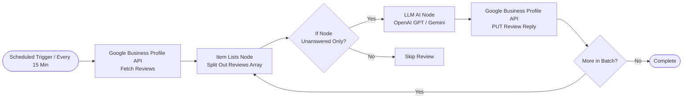
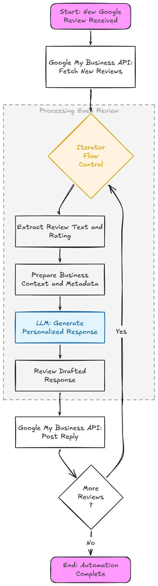
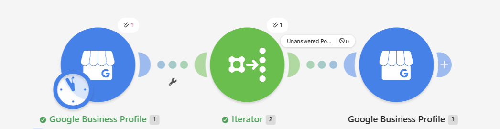

# Google Maps Review Auto Reply Automation (AI-Powered with n8n)

[](https://n8n.io/)
[](https://developers.google.com/my-business)
[](https://openai.com/)
[](https://ai.google.dev/)
[](#)

An automated, production-ready workflow built on **n8n** that fetches historical and incoming **Google Maps Reviews**, analyzes customer sentiment and comments using **LLMs (OpenAI GPT-4o-mini / Google Gemini)**, and automatically publishes personalized, professional replies back to Google Business Profile.

---

## Workflow Architecture



### Visual References
| Workflow Logic Flowchart | n8n Automation Scenario Structure |
| :---: | :---: |
|  |  |

---

## Key Features

- **Contextual AI Responses:** Generates custom, human-like replies based on reviewer name, star rating, and specific comments rather than generic static templates.
- **Automatic Multi-lingual Adaptation:** Intelligently matches the customer's language (English, Hindi, or Hinglish).
- **Duplicate Prevention:** Integrated If node checks `reviewReply` state to guarantee no review is ever replied to twice.
- **Handles Old and New Reviews:** Supports pagination to clear backlogs of unanswered past reviews as well as monitoring fresh reviews on a recurring schedule.
- **Smart Sentiment Routing (Optional):**
  - **4-5 Star Reviews:** Immediate AI appreciation reply published automatically.
  - **1-3 Star Reviews:** AI drafts an empathetic resolution reply and sends alerts via Slack, Telegram, or Email for staff approval before publishing.
- **Local SEO Boost:** Fast, consistent replies signal active management to Google's ranking algorithm, improving Google Maps local search visibility.

---

## Repository Structure

```text
google_maps_review_auto_reply_automation/
├── README.md                               # Project documentation
└── google-review-auto-reply/
    ├── setup-guide.md                      # Detailed step-by-step implementation guide
    └── screenshots/
        ├── automation-screen.png           # Automation workflow canvas screenshot
        └── flow-digram.png                 # Detailed logic flowchart
```

---

## Quick Setup Overview

For full step-by-step instructions with exact API paths, credentials, and parameter mappings, see the complete guide:  
[Detailed Setup Guide (google-review-auto-reply/setup-guide.md)](google-review-auto-reply/setup-guide.md)

### Summary of Steps:

1. **Google Business Profile API Connection:**
   - Fetch your `Account ID` via `GET /v1/accounts`.
   - Fetch your `Location ID` via `GET /v1/accounts/{accountId}/locations`.
2. **Fetch Reviews:**
   - Call `GET /v4/accounts/{accountId}/locations/{locationId}/reviews?pageSize=50`.
3. **Item Lists Node (Split Out Items):**
   - Split out the `reviews` array into individual items.
4. **If Node (Filter):**
   - Check that `reviewReply` is empty to process only unanswered reviews.
5. **AI Node Integration:**
   - Add **OpenAI** node (`gpt-4o-mini`) or **Google Gemini** node.
   - Configure prompt with reviewer's display name, rating, comment, and brand voice.
6. **Publish Reply:**
   - Use an **HTTP Request** node with `PUT` method:  
     `https://mybusiness.googleapis.com/v4/{reviewName}/reply`
   - Map payload: `{"comment": "{{ $json.message.content }}"}`.
7. **Schedule:**
   - Set execution interval to **Every 15 minutes** and toggle the workflow to **Active**.

---

## AI Prompt Engineering Template

Here is the recommended prompt template configured for **Apex Dental Care**:

### System Prompt
```text
You are the professional patient care coordinator for "Apex Dental Care".
Your task is to craft an authentic, warm, polite, and personalized reply to Google Maps reviews.

Guidelines:
1. Keep the reply brief and natural (2-3 sentences max).
2. Personalize the reply using the reviewer's display name.
3. If the reviewer shared specific feedback, acknowledge what they appreciated.
4. If there is no comment (star rating only), express warm gratitude for their support.
5. Match the language tone of the review (Hindi/Hinglish or English).
6. Never make medical guarantees or offer unauthorized discounts publicly.
7. Return ONLY the final reply text without quotes, subject lines, or notes.
```

### User Input Prompt
```text
Reviewer Name: {{ $json.reviewer.displayName }}
Star Rating: {{ $json.starRating }}
Review Text: {{ $json.comment ? $json.comment : "No comment provided, star-only review" }}

Generate the reply:
```

---

## Security and Production Best Practices

- **Credential Management:** Store OpenAI API keys and Google OAuth2 credentials securely inside n8n Credentials.
- **Dry-run Testing:** Test with a single review ID filter before activating the scheduled workflow.
- **Rate Limit and Quota Monitoring:** Ensure your OpenAI or Gemini account has sufficient quota and balance limits.

---

## License and Credits

- Created for automated Google Business Profile review management.
- Built with n8n, Google Business Profile API, and OpenAI / Gemini.
