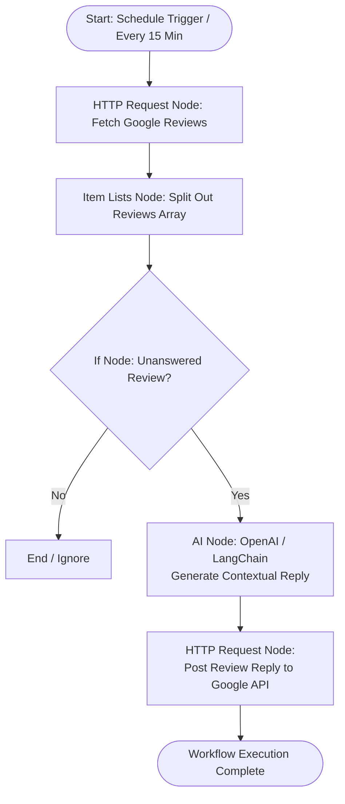

# Google Maps Review Auto Reply Automation – Complete Guide (With n8n & AI Integration)

**Platform:** n8n + Google Business Profile API + AI (OpenAI GPT-4o-mini / Google Gemini)  
**Example Business:** Karim Path Lab  
**Purpose:** Google Maps ke purane aur naye unanswered reviews par dynamic, personalized aur contextual AI reply dena using self-hosted ya cloud n8n.

**Important:** Is guide mein diye gaye Account ID aur Location ID dummy hain. Actual setup mein apne business ki real IDs aur API credentials use karni hongi.

---

## Architecture & Automation Flow



*(Flow diagram reference: [screenshots/flow-digram.png](screenshots/flow-digram.png))*  
*(Workflow canvas structure reference: [screenshots/automation-screen.png](screenshots/automation-screen.png))*

---

## Step 1 – n8n Par New Workflow Banao

1. Apne n8n instance (Cloud ya Self-hosted Docker/Desktop) par login karo.
2. Left menu se **Workflows → Add Workflow** par click karo.
3. Workflow ka naam rakho: `Google Maps Review AI Auto Reply`.
4. Trigger ke liye **Schedule Trigger** node add karo:
   - **Trigger Interval:** Every 15 Minutes (ya Custom Cron).

---

## Step 2 – Google Business Account ID Nikalo

Reviews API access karne ke liye aapko Google Business Profile Account ID ki zarurat hoti hai.

**Node:** HTTP Request

**Settings:**
- **Authentication:** `Predefined Credential Type` → `Google OAuth2 API` (ya OAuth2 API credentials jisme Business Profile scopes enabled hon)
- **Method:** `GET`
- **URL:** `https://mybusinessaccountmanagement.googleapis.com/v1/accounts`

**Execute Step:**

Response JSON:
```json
{
  "accounts": [
    {
      "name": "accounts/123456789012345",
      "accountName": "Karim Path Lab",
      "type": "PERSONAL"
    }
  ]
}
```

> **Dummy Account ID:** `123456789012345`  
> Is ID ko agle API URLs mein use karna hai.

---

## Step 3 – Google Business Location ID Nikalo

Location ID fetch karne ke liye agla API call lagao:

**Node:** HTTP Request

**Settings:**
- **Method:** `GET`
- **URL:** `https://mybusinessbusinessinformation.googleapis.com/v1/accounts/123456789012345/locations`
- **Query Parameters:**
  - `readMask`: `name,title`

**Execute Step:**

Output response:
```json
{
  "locations": [
    {
      "name": "locations/987654321098765",
      "title": "Karim Path Lab"
    }
  ]
}
```

> **Dummy Location ID:** `987654321098765`

---

## Step 4 – Google Maps Reviews Fetch Karo

**Node:** HTTP Request

**Settings:**
- **Authentication:** Google OAuth2 API Credential
- **Method:** `GET`
- **URL:**
  ```text
  https://mybusiness.googleapis.com/v4/accounts/123456789012345/locations/987654321098765/reviews
  ```
- **Query Parameters:**
  - `pageSize`: `50`

**Execute Step:**

Output JSON mein reviews ka array aayega:
- `reviews[].reviewer.displayName` (Customer name)
- `reviews[].reviewId` (Unique ID)
- `reviews[].starRating` (`ONE`, `TWO`, `THREE`, `FOUR`, `FIVE`)
- `reviews[].comment` (Review text content)
- `reviews[].reviewReply` (Agar pehle se reply ho toh maujood hoga, unanswered mein null/undefined hoga)

---

## Step 5 – Item Lists Node Add Karo (Split Out / Iterator)

Google API pura `reviews` array ek item ke andar return karti hai. Har review ko individually process karne ke liye n8n ka **Item Lists** node use karte hain:

1. HTTP Request node ke aage `+` par click karo.
2. Search karo: **Item Lists**.
3. **Operation:** `Split Out Items`.
4. **Field to Split Out:** `reviews`.
5. **Execute Node** karo.

**Result:** Ab n8n mein har ek review alag item bankar aage flow hoga.

---

## Step 6 – If Node Configure Karo (Unanswered Reviews Filter)

Pehle se replied reviews ko dubara reply karne se rokne ke liye:

1. Item Lists ke aage `+` click karo aur **If** node select karo.
2. Filter condition:
   - **Value 1:** `{{ $json.reviewReply }}`
   - **Operation:** `Is Empty` (ya `Does not exist`)
3. *(Optional Condition for 5-Star only)*:
   - **AND Rule:** `{{ $json.starRating }}` equals `FIVE`

**Output:**
- **True branch:** Sirf wahi reviews aage jayenge jinka abhi tak koi reply post nahi hua hai.
- **False branch:** Empty rakho (skip).

---

## Step 7 – AI Node Add Karo (OpenAI / LangChain Node)

True branch ke baad customized response generate karne ke liye AI node connect karein.

### OpenAI Node Configuration:
1. True branch ke aage `+` click karo aur **OpenAI** node select karo.
2. **Resource:** `Chat`
3. **Operation:** `Complete`
4. **Model:** `gpt-4o-mini` (Fast, cost-effective and accurate)
5. **Credential:** Apni OpenAI API Key select karo.

#### System Message:
```text
You are the polite and professional patient care coordinator for "Karim Path Lab".
Your task is to craft an authentic, warm, polite, and personalized reply to Google Maps reviews.

Guidelines:
1. Keep the reply brief and natural (2-3 sentences max).
2. Personalize the reply using the reviewer's display name.
3. If the reviewer shared specific feedback, acknowledge what they appreciated.
4. If there is no comment (star rating only), express warm gratitude for their 5-star support.
5. Match the language of the review (reply in Hindi/Hinglish if review is in Hindi/Hinglish; English if in English).
6. Never make medical guarantees or offer unauthorized discounts publicly.
7. Return ONLY the final reply text without quotes or prefixes.
```

#### User Prompt:
```text
Reviewer Name: {{ $json.reviewer.displayName }}
Star Rating: {{ $json.starRating }}
Review Comment: {{ $json.comment ? $json.comment : "No comment provided, star-only review" }}

Generate the reply:
```

---

## Step 8 – Google Business Profile Review Reply Post Karo

AI se reply generate hone ke baad use Google Maps par live post karne ke liye:

1. OpenAI node ke baad `+` click karo aur **HTTP Request** node add karo.
2. Settings:
   - **Authentication:** Google OAuth2 API Credential
   - **Method:** `PUT`
   - **URL:**
     ```text
     https://mybusiness.googleapis.com/v4/{{ $('Item Lists').item.json.name }}/reply
     ```
     *(Yahan `name` ka format `accounts/.../locations/.../reviews/...` hota hai)*
   - **Send Body:** Yes
   - **Body Content Type:** `JSON`
   - **Specify Body:** `Using Fields Below` ya `JSON`
   - **JSON Body:**
     ```json
     {
       "comment": "={{ $json.message.content }}"
     }
     ```

**Save** karo.

---

## Step 9 – Advanced Sentiment Routing (Optional)

Agar aap negative reviews (1-2 star) par direct reply ke bajaye staff approval chahte hain, toh If node ke baad **Switch** ya **Router** laga sakte hain:

- **Path A (4 & 5 Stars):** OpenAI Node → HTTP Request (Auto Post to Google).
- **Path B (1, 2 & 3 Stars):** OpenAI Node (Empathetic Draft) → Slack / Telegram / Gmail Node (Alert clinic manager with approval link).

---

## Step 10 – Workflow Safely Test Karo

1. Workflow ko abhi **Inactive** rakhein.
2. If node mein temporarily customer ka specific `reviewId` check condition add karein.
3. **Test Workflow** par click karein.
4. n8n execution canvas par har node ka output inspect karein:
   - Google Review successfully fetch hua?
   - Item Lists ne array cleanly split kiya?
   - If node ne unanswered review cleanly filter kiya?
   - OpenAI ne natural aur personalized message generate kiya?
   - HTTP Request ne 200 OK return kiya?
5. Google Maps listing par verify karein ki reply visible hai.
6. Test pass hone ke baad temporary test condition hata dein.

---

## Step 11 – Workflow Active Karo

1. Top-right switch se workflow ko **Active** toggle karein.
2. Ab Schedule Trigger har 15 minute run hoga aur naye/purane sabhi unanswered reviews par automatic response dega.

---

## Static vs AI-Powered Reply Comparison

| Feature | Static Template Reply | AI-Powered Auto Reply (Current Setup) |
| :--- | :--- | :--- |
| **Personalization** | Sirf fixed generic message | Customer ke review comment par contextual reply |
| **Customer Name** | Usually nahi hota ya manual | Natural sentence structure mein patient/customer ka name use |
| **Language Support** | Sirf 1 static language | Auto-detects English, Hindi, Hinglish & replies accordingly |
| **Rating Adaptability** | Har star par ek jaisa message | 5-star par gratitude, 4-star par feedback acknowledgment |
| **Local SEO Impact** | Low engagement | High – Relevant service keywords naturally include hote hain |

---

## Common Errors & Solutions

| Problem | Cause | Solution |
| :--- | :--- | :--- |
| **404 Not Found** | Galat Account ID ya Location ID | Step 2 aur Step 3 repeat karke real numeric IDs verify karein |
| **401 / 403 Forbidden** | Google OAuth token expired ya missing permissions | n8n Credentials mein Google account reconnect karein |
| **AI Reply contains quotation marks** | LLM output mein `"` shuru aur aakhir mein aa gaya | System prompt mein "Do not include quotes" specify karein ya expression mein `.replace(/^"|"$/g, '')` use karein |
| **OpenAI 429 Quota Exceeded** | OpenAI API balance 0 ho gaya hai | OpenAI billing settings mein credits check karein |
| **Double Replies on Same Review** | If node mein `reviewReply Is Empty` missing hai | If node conditions dobara check karein |

---

## Final Setup Checklist

- [ ] Google OAuth2 API credential connected in n8n
- [ ] Real Account ID & Location ID retrieved
- [ ] Reviews API call verified with sample response
- [ ] Item Lists node configured to split `reviews` array
- [ ] If node configured for `reviewReply is empty`
- [ ] OpenAI API credential connected in n8n
- [ ] Prompt customized for Karim Path Lab brand voice
- [ ] Dynamic tokens mapped (`displayName`, `comment`, `starRating`)
- [ ] HTTP Request PUT method configured for reply endpoint
- [ ] Single review par manual test execution successful
- [ ] Schedule Trigger set (Every 15 Minutes)
- [ ] Workflow toggled to Active
